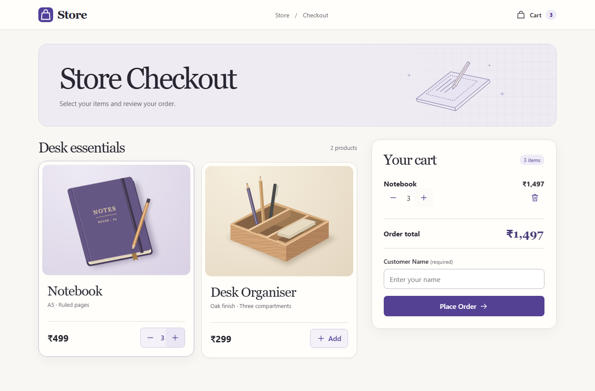

# Store Checkout

**Live site** · <https://fynd-r1.web.app/>

A single-page checkout built with React and TypeScript. Adjust quantities for a Notebook (₹499) or Desk Organiser (₹299), enter a customer name and place the order. The receipt shows the reference, customer, quantities and total. Refreshing starts a new cart.



## Run locally

**Prerequisites** · Git, Node.js 22.x (22.12 or later), and npm. The recorded Windows run used Node.js 22.17.1 and npm 10.9.2.

### Start the development server

```sh
git clone https://github.com/yashgadge/fynd.git checkout-app
cd checkout-app
npm ci
npm run dev
```

Open the local URL printed by Vite.

### Preview a production build

```sh
npm run lint
npm run build
npm run preview
```

The build runs strict TypeScript checks on the application, tests and Playwright configuration before writing static files to `dist/`.

Stop the preview with Ctrl+C before running local browser tests so the runner can use port 4173.

## Browser tests

```sh
npx playwright install chromium
npx playwright test
npx playwright show-report
```

Leave port 4173 free for the test runner. It builds the application, starts a preview and runs each test in a fresh Chromium context. Each test opens the checkout and verifies that the cart starts empty. Use `npx playwright test --headed` to watch the run. On Linux, use `npx playwright install --with-deps chromium` if browser libraries are missing.

Rerunning the suite replaces the AT-01 through AT-03 screenshots in `evidence/automation/`. Playwright writes the HTML report to `playwright-report/` and failure traces and screenshots to `test-results/`. The execution record links the saved report capture, Edge screenshots and recording. See the [checkout test plan](TEST_PLAN.md) and [test execution results](TEST_RESULTS.md).

### Test results · 23 November 2026

| Environment | Coverage | Result |
|---|---|---|
| Chromium · local preview | Receipt, required name, exact totals and rapid double-click at 320px | 4 passed in 9.9s |
| Chromium · live site | Same four automated cases against the deployed build | 4 passed in 8.7s |
| Microsoft Edge · manual | Empty-cart validation and rapid double-click | 2 passed |

[Playwright report](evidence/automation/report.png) · [Manual test results](TEST_RESULTS.md#manual-test-cases) · [Edge recording](evidence/manual/checkout.webm)

## Checkout rules

- **Prices and quantities.** The catalogue in `src/data/products.ts` stores prices in integer paise. Each line amount is its unit price multiplied by its quantity. The order total is the sum of the lines. Removing the final unit removes the line. Both sets of quantity controls read the same cart state.
- **Validation.** Checkout requires a nonempty cart and a name containing at least one non-whitespace character. A failed submission displays the applicable inline errors and retains the cart and name.
- **Confirmation.** A synchronous guard in `src/App.tsx` locks a valid submission before React displays the receipt. The receipt keeps the submitted line amounts, total, trimmed name and order reference. Keyboard focus moves to the confirmation heading.
- **Presentation.** The components in `src/components/` use labelled controls and inline validation messages. Plain CSS handles the responsive layout and respects reduced-motion preferences. Product illustrations are served locally.

## Hosting and limitations

Serve the production build at the site root over HTTPS, or use localhost for development. The reference uses `crypto.randomUUID()`. Checkout has no backend, payment integration or persistent order history. Totals include product prices only.

Firebase Hosting serves `dist/` using the repository's `firebase.json`. To publish a new version with an authorized Firebase account:

```sh
npm run build
npx --package firebase-tools firebase deploy --only hosting --project fynd-r1
```

To run Playwright against the live site from PowerShell:

```powershell
$env:BASE_URL = 'https://fynd-r1.web.app/'
npx playwright test
Remove-Item Env:BASE_URL
```

## Third-party notices

| Software | Use | License |
|---|---|---|
| React, React DOM and Scheduler (Meta Platforms and contributors) | UI rendering and updates | MIT |
| Vite (VoidZero and Vite contributors) | Development server, production build and preview | MIT |
| Microsoft TypeScript and Playwright Test | Type checking and browser tests | Apache-2.0 |
| ESLint and typescript-eslint | Static analysis | MIT |
| DefinitelyTyped declarations for Node.js, React and React DOM | Type information | MIT |

The runtime notices ship with the static build. Development packages include their license texts in their npm distributions. The SVG illustrations and interface icons are project assets. This repository specifies third-party licenses only. [Runtime copyright and license notices](public/THIRD_PARTY_NOTICES.txt) · [Locked dependency versions](package-lock.json)
